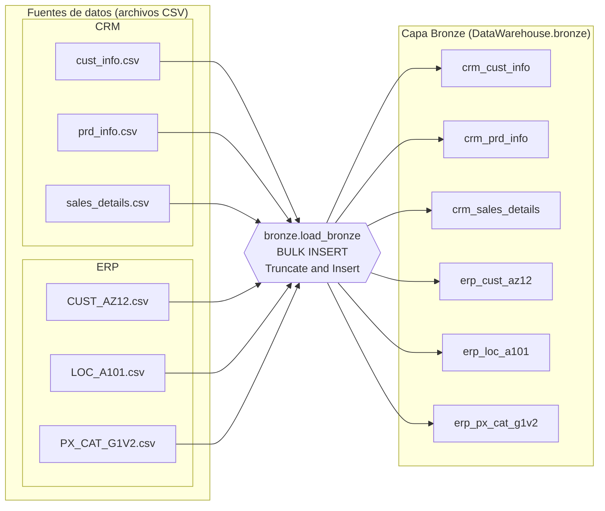

# Flujo de datos: capa Bronze

Este diagrama muestra cómo viajan los datos desde los archivos CSV de los sistemas de origen hasta las tablas de la capa Bronze.

## Correspondencia archivo → tabla

| Sistema | Archivo CSV | Tabla Bronze | Filas |
|---|---|---|---|
| CRM | `cust_info.csv` | `bronze.crm_cust_info` | 18 494 |
| CRM | `prd_info.csv` | `bronze.crm_prd_info` | 397 |
| CRM | `sales_details.csv` | `bronze.crm_sales_details` | 60 398 |
| ERP | `CUST_AZ12.csv` | `bronze.erp_cust_az12` | 18 484 |
| ERP | `LOC_A101.csv` | `bronze.erp_loc_a101` | 18 484 |
| ERP | `PX_CAT_G1V2.csv` | `bronze.erp_px_cat_g1v2` | 37 |

## Cómo se ejecuta

1. `03_scripts/init_database.sql`: crea la base `DataWarehouse` y los esquemas.
2. `03_scripts/bronze/ddl_bronze.sql`: crea las 6 tablas Bronze.
3. `03_scripts/bronze/proc_load_bronze.sql`: crea el procedimiento.
4. `EXEC bronze.load_bronze;`: carga los 6 CSV (carga completa, Truncate & Insert).
5. `04_tests/quality_checks_bronze.sql`: valida filas, columnas y contenido.

## Características de la capa

- **Objeto:** tablas.
- **Carga:** por lotes, completa (Truncate & Insert).
- **Transformación:** ninguna; los datos quedan tal como llegan.
- **Modelo de datos:** ninguno.
- **Siguiente capa:** Silver, que toma estas tablas y limpia los problemas de calidad documentados en `analisis_origenes.md`.
