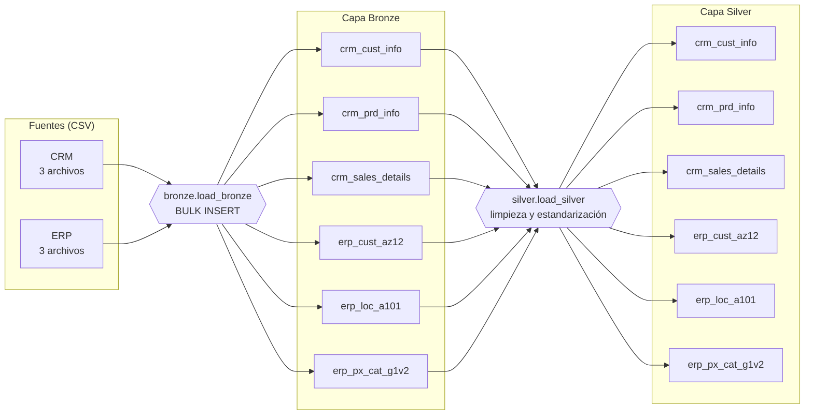
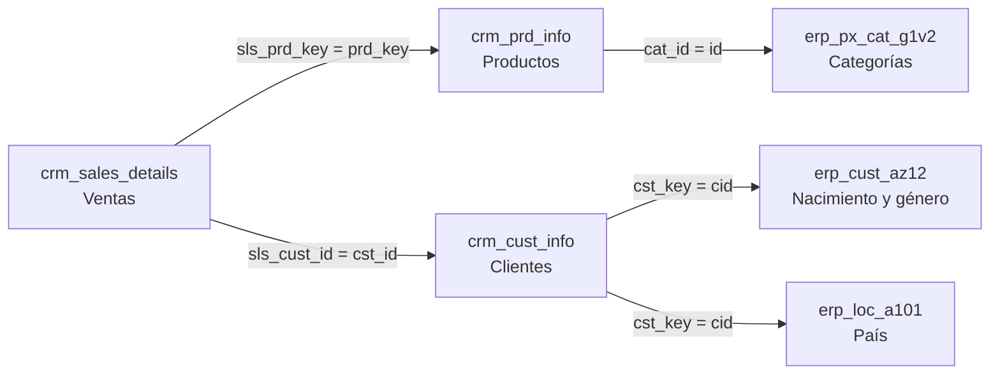

# Flujo de datos: capa Silver

## 1. Flujo completo (CSV → Bronze → Silver)

## 2. Integración de datos en Silver (cómo se unen las tablas)

## 3. Transformaciones aplicadas por tabla

| Tabla Silver | Transformaciones |
|---|---|
| `crm_cust_info` | Quita `cst_id` nulos; deja el registro más reciente por cliente; `TRIM` a nombres; estado civil → Single/Married/n/a; género → Female/Male/n/a |
| `crm_prd_info` | Separa `prd_key` en `cat_id` y `prd_key`; costo nulo → 0; línea → Mountain/Road/Other Sales/Touring/n/a; `prd_end_dt` recalculada con `LEAD()` |
| `crm_sales_details` | Fechas `INT` → `DATE` (0 o inválidas → NULL); ventas recalculadas como cantidad × precio; precio derivado cuando falta |
| `erp_cust_az12` | Quita el prefijo `NAS` de `cid`; fechas de nacimiento futuras → NULL; género → Female/Male/n/a |
| `erp_loc_a101` | Quita el guion de `cid`; país estandarizado (DE → Germany, US/USA → United States, vacío → n/a) |
| `erp_px_cat_g1v2` | Sin cambios |

Todas las tablas agregan la columna técnica `dwh_create_date`.

## 4. Cómo se ejecuta

1. `03_scripts/silver/ddl_silver.sql`: crea las 6 tablas Silver.
2. `03_scripts/silver/proc_load_silver.sql`: crea el procedimiento.
3. `EXEC bronze.load_bronze;` y luego `EXEC silver.load_silver;`.
4. `04_tests/quality_checks_silver.sql`: valida la calidad de Silver.

## 5. Características de la capa

- **Objeto:** tablas.
- **Carga:** por lotes, completa (Truncate & Insert).
- **Transformación:** limpieza, estandarización, normalización, columnas derivadas y enriquecimiento.
- **Modelo de datos:** ninguno; mantiene la estructura de las tablas de origen.
- **Siguiente capa:** Gold, con las vistas del modelo estrella.
